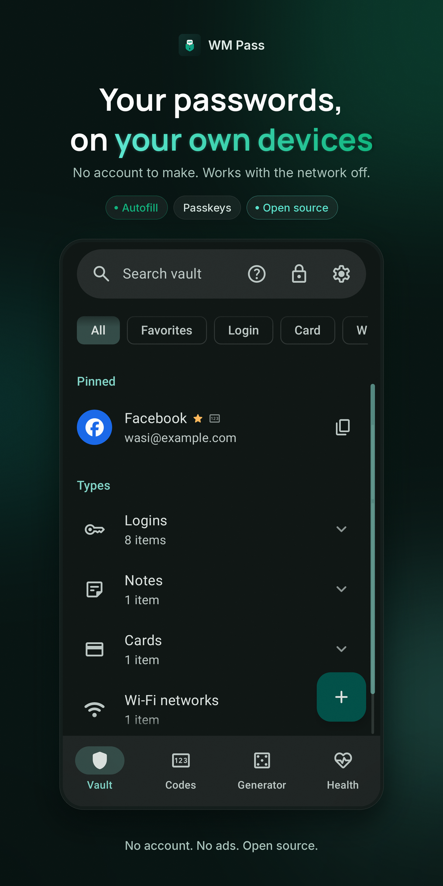
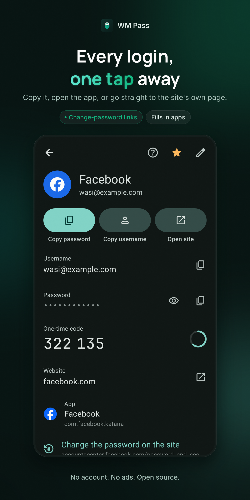
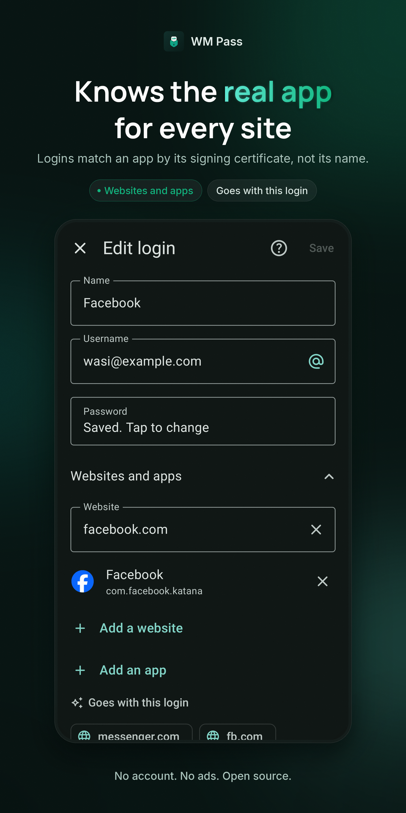
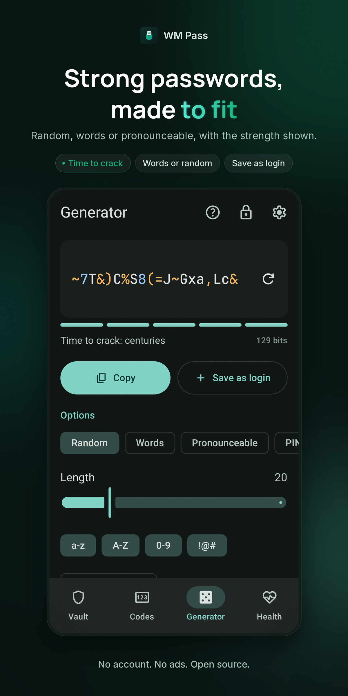
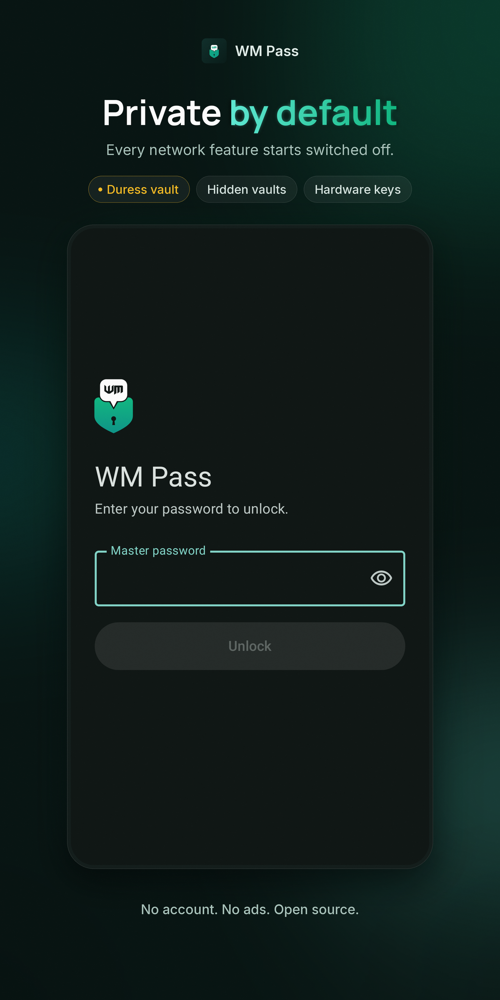

<div align="center">


# WM Pass

### No account. No ads. Open source.

A password manager from the WM Suite that keeps its vault on your own devices. It works with
the network off, and every network feature starts switched off.

<a href="https://github.com/wasi-master/wm-pass/actions/workflows/ci.yml"></a>
<a href="https://wmpass.pages.dev"></a>
<a href="https://wmpass.pages.dev/vault/"></a>
<a href="https://supportkori.com/wasimaster"></a>
<a href="LICENSE"></a>

<a href="#install">Install</a> · <a href="#the-tour">Tour</a> · <a href="#every-platform">Platforms</a> · <a href="#privacy">Privacy</a> · <a href="#faq">FAQ</a> · <a href="#build-it-yourself">Build</a> · <a href="https://wmpass.pages.dev"><b>Read the docs</b></a>

</div>

## Why it exists

Most password managers start with an account. Your vault lives on their server, you sign in to
reach it, and the whole arrangement depends on that company staying honest, solvent and
unbreached. The ones that skip the account tend to stop at a file and a desktop window, which
leaves you to work out autofill, sync, codes and passkeys on your phone by yourself.

WM Pass keeps the file and drops the account. The vault is one encrypted `.wmvault` file on your
own devices, and nobody can reset its password, WM Pass included. Everything around it is what you
would expect from a hosted manager: autofill on Android and in the browser, passkeys, one-time
codes, a health report, backups to wherever you already keep files, and sync between your devices
over your own network. All of it runs over one Rust core, so a vault means the same thing on a
phone, a laptop, a browser tab and a terminal.

## A few screenshots

<table>
  <tr>
    <td></td>
    <td></td>
    <td></td>
    <td></td>
    <td></td>
    <td></td>
    <td></td>
    <td></td>
  </tr>
</table>

## The tour

### The vault

- **One encrypted file.** Items are sealed under a random vault key, and each way in (a password,
  a password with a key file, or a password with a security key) opens a slot holding a copy of
  it. The file has room for eight, and unused slots are random bytes, so the file does not say
  how many ways in it has.
- **Slow to guess.** The master password goes through Argon2id with at least 64 MiB of memory,
  and WM Pass refuses a file that asks for less. Contents are padded and sealed in chunks with a
  fresh key on every save.
- **Twelve kinds of item:** logins, codes, notes, cards, identities, recovery codes, Wi-Fi
  networks, SSH keys, API keys, databases, licenses and documents. Each can carry tags, folders,
  custom fields, attachments, links to other items, a reminder and a self-destruct date, and the
  old values of its secret fields stay in its history.
- **Search that stays out of secrets.** Typos are forgiven, and words like `kind:card`,
  `has:passkey`, `reused` or `modified>1y` narrow it down. It never looks inside a password.

[How it works](https://wmpass.pages.dev/guide/how-it-works/) · [The file format](https://wmpass.pages.dev/security/format/) · [Your first vault](https://wmpass.pages.dev/start/first-vault/)

### Filling and codes

- **Autofill on Android** matches apps by package name and signing certificate, not by name, so a
  look-alike app gets nothing. Saved logins show in the keyboard's suggestion row too.
- **The browser extension** fills from a small key at the edge of a login field, offers to save
  new sign-ins, and holds passkeys. It can keep its own vault or use the one open in the desktop
  app, over a sealed channel you pair once with a six-digit code.
- **An authenticator built in.** Time-based codes, counter-based codes and Steam Guard, with the
  next code shown in the last ten seconds. Google Authenticator's transfer QR codes import directly.
- **Passkeys** on Android and in the extension.
- **On a computer:** quick search from a global shortcut, auto-type when you turn it on, an SSH
  agent that answers `ssh` and `git` from your vault, and a tray icon that still locks on time.

[Android](https://wmpass.pages.dev/apps/android/) · [Extension](https://wmpass.pages.dev/apps/extension/) · [Desktop](https://wmpass.pages.dev/apps/desktop/)

### Backups and sync

- **Backups go where you already keep files:** a local folder, Google Drive, Dropbox, OneDrive,
  Box, pCloud, MEGA, iCloud Drive, Proton Drive, WebDAV, S3, SFTP, FTP, SMB, NFS, a Synology or
  QNAP NAS, a Git repository, or a mailbox over IMAP. Every backup is read back and compared
  before an older copy is removed.
- **Sync merges field by field.** When two devices change the same password, the losing value goes
  into that item's history, so a conflict never destroys a password. A place that hands back an
  older copy than this device has seen raises a warning.
- **Sync on your own network**, device to device with no server, paired once by QR code.
- **Accounts held elsewhere:** a Bitwarden or Vaultwarden account, a KeePass database opened where
  it is, or a WM Pass server you run yourself.
- **Nested and shared vaults.** A vault inside a vault, or one shared with other people, each with
  their own key to it.

[Backups and sync](https://wmpass.pages.dev/guides/backup-sync/) · [The LAN protocol](https://wmpass.pages.dev/security/lan/)

### Under pressure

- **Duress passwords** look like any other at the door, and open a decoy vault, wipe this
  device's copy, or lock hard and alert you.
- **Hidden vaults and a hidden shelf.** Decoy files of the same shape sit beside the real one, and
  the shelf keeps chosen items out of every list, search and autofill until you open it.
- **Emergency access** splits a recovery key into Shamir shares, such as any three of five, each
  on a printable sheet with a QR code.
- **Hardware keys:** a FIDO2 security key, or a YubiKey's challenge-response slot.

These help against a quick look, not forensics. The [threat model](https://wmpass.pages.dev/security/threat-model/)
says plainly what each one can and cannot do.

[Duress and hidden vaults](https://wmpass.pages.dev/guides/duress/) · [Emergency access](https://wmpass.pages.dev/guides/emergency-access/)

### Health and tools

- **A health score** that lists breached, reused, easy-to-guess and old passwords, sites without
  a second factor, and duplicate items, worst first.
- **A generator** for random passwords, words or pronounceable ones, with the time to crack shown.
  Site rules from Apple's password-manager-resources shape what it makes.
- **Email aliases** through SimpleLogin, addy.io, Firefox Relay, DuckDuckGo or your own address,
  a disposable inbox, and a username checker.

### Moving in

Guides for 39 apps you might be leaving, among them 1Password, Bitwarden, LastPass, Dashlane,
Proton Pass, Apple Passwords, Chrome, Firefox, KeePass and every common authenticator. Each guide
has the export steps for that app, Android first.

[Import and export](https://wmpass.pages.dev/guides/import-export/)

## Every platform

| | What it is |
|---|---|
| **Android** | The fullest version: autofill service, passkeys, widgets, a Quick Settings tile and panic controls. Android 8.0 or newer |
| **Wear OS** | Codes and favorites on your watch while the phone's vault is open. The watch keeps nothing |
| **Desktop** | macOS, Windows and Linux. Quick search, auto-type, the SSH agent, the tray, and widgets on macOS 14 and later |
| **Browser extension** | Chrome and Firefox 140 or later. Fills, saves, holds passkeys, and opens the full app in a tab |
| **Web vault** | The whole app in a tab at [wmpass.pages.dev/vault](https://wmpass.pages.dev/vault/), running as WebAssembly, with nothing about your vault sent to the site |
| **Terminal** | `wmpass`: a full-screen terminal app, and subcommands for scripts. Shares the desktop app's vault when both are on one computer |
| **WM Keyboard** | [WM Keyboard](https://wmkeyboard.pages.dev)'s WM Pass tool lists, types from and adds to your vault without leaving the app you are in |

## Privacy

WM Pass has no account, no analytics and no server it needs to reach. The vault opens, fills,
generates and checks health with the radio off.

Every feature that touches the network starts switched off and says what it sends before you turn
it on:

- Breach checks send the first five characters of each password's SHA-1 hash to Have I Been Pwned.
- Email aliases send your API key and note to the forwarding service you chose.
- Backups and sync send the encrypted vault file to the place you picked, and nowhere else.
- Accounts sign in to Bitwarden, Vaultwarden or your own server. Your master password is never sent.
- Sync on your own network talks only to devices you paired.

Copied passwords are marked to stay out of clipboard history and cleared after 60 seconds.

[What it protects against](https://wmpass.pages.dev/security/threat-model/) · [Privacy policy](https://wmpass.pages.dev/privacy/)

## Install

Releases are on the [GitHub releases page](https://github.com/wasi-master/wm-pass/releases), one
tag family per app: `android-v`, `desktop-v`, `extension-v` and `cli-v`.

- **Android:** the APK from GitHub releases. F-Droid and Play listings will follow.
- **macOS:** `brew install --cask wm-pass`, or the `.dmg`.
- **Arch Linux:** `yay -S wm-pass-bin`. Other distributions get `.deb`, `.rpm` and `.AppImage`.
- **Windows:** the installer from the releases page.
- **Firefox:** `wm-pass-firefox.xpi`, signed by Mozilla. Drag it onto a Firefox window.
- **Chrome:** the release zip, until the store listing is up.
- **Terminal:** a single `wmpass` file for macOS, Linux or Windows. Put it on your `PATH`.
- **Web:** nothing to install. Open [wmpass.pages.dev/vault](https://wmpass.pages.dev/vault/).

Desktop builds carry no Apple or Windows signature, so macOS and Windows warn the first time you
open them. Every release has a `SHA256SUMS` file, and updates carry a minisign signature that the
app checks before installing.

[Install](https://wmpass.pages.dev/start/install/) · [Make your first vault](https://wmpass.pages.dev/start/first-vault/)

## FAQ

<details>
<summary><b>What if I forget my master password?</b></summary>
<br>
Then the vault is gone, unless you set up another way in or made an emergency kit. There is no
account and no server holding a copy, so there is nothing to reset. That is also what keeps
anyone else from opening it. Add a second password, a key file or emergency shares while you can.
</details>

<details>
<summary><b>How do I get the same vault on my phone and my computer?</b></summary>
<br>
Pick one of three: point both at the same backup place and turn on sync, pair them over your own
network, or sign both in to a Bitwarden, Vaultwarden or self-hosted WM Pass account. Changes merge
field by field either way.
</details>

<details>
<summary><b>Can I keep using my KeePass file?</b></summary>
<br>
Yes. A KeePass database opens where it is, and WM Pass writes back to it on each save, keeping one
earlier copy beside it. Key files and KeePassXC's YubiKey challenge-response both work. The writer is
the <code>keepass</code> crate's experimental KDBX 4 writer, so every save is read back and compared.
</details>

<details>
<summary><b>Has it been audited?</b></summary>
<br>
Not yet. One is planned for <code>wmpass-core</code> before version 1.0. The file format is
published, and only RustCrypto and dalek primitives are used, with no new constructions.
</details>

<details>
<summary><b>Why does macOS or Windows warn when I open it?</b></summary>
<br>
The desktop builds are unsigned, so the warning cannot tell you whether the file is genuine. Check
it against the release's <code>SHA256SUMS</code>. On macOS, right-click the app and choose Open; on
Windows, choose More info, then Run anyway. macOS also has no biometric unlock for the same reason.
</details>

<details>
<summary><b>Should I use the web vault or the extension?</b></summary>
<br>
The extension, if you can. Its code comes signed from the browser's store and changes only with an
update, while the web vault's code arrives from the website on each visit. The web vault also keeps
its vault in the browser's storage for that site, so clearing site data deletes it. Set up a backup
before you rely on it.
</details>

## Documentation

**<a href="https://wmpass.pages.dev">wmpass.pages.dev</a>** is the full manual, with a page for
each app, each guide and every settings screen. The settings pages are generated from
`help/topics/`, the same text the apps show in their own help.

| Start here | Go deeper |
|---|---|
| [Install](https://wmpass.pages.dev/start/install/) | [Threat model](https://wmpass.pages.dev/security/threat-model/) |
| [Your first vault](https://wmpass.pages.dev/start/first-vault/) | [File format](https://wmpass.pages.dev/security/format/) |
| [Import and export](https://wmpass.pages.dev/guides/import-export/) | [The LAN protocol](https://wmpass.pages.dev/security/lan/) |
| [Backups and sync](https://wmpass.pages.dev/guides/backup-sync/) | [How it works](https://wmpass.pages.dev/guide/how-it-works/) |

The site lives in [`docs/`](docs/) and runs on Astro Starlight.

## Build it yourself

```bash
git submodule update --init
```

```bash
cargo test --workspace
```

```bash
npm ci && npm run extension:build
```

```bash
cargo tauri build
```

```bash
cargo run -p wmpass-cli
```

`cargo tauri build` runs from `desktop/src-tauri`, and `cargo run -p wmpass-cli` opens the
terminal app. The Android app builds from `android/` with `./gradlew assembleDebug`, and needs the
NDK and `cargo-ndk`. Pass `-Pwmpass.fdroid=true` to leave out Google's SDKs (the Wearable API and
ML Kit), or `-Pwmpass.offline=true` to drop the internet permission and those SDKs with it.

The extension build writes `extension/dist/chrome` and `extension/dist/firefox`, and
`npm run extension:lint` checks the Firefox one with Mozilla's `web-ext`. The browser tests run
with `node extension/test/run.mjs` after building the extension, and `node web/test/run.mjs` after
`npm run web:build`. `npm run site:build` puts the web vault under the docs site's `/vault/`, with
its headers from `docs/public/_headers`.

<details>
<summary><b>Releases</b></summary>

<br>

The `Extension release` workflow runs from an `extension-v*` tag that matches the manifest's
version, and has Mozilla sign the Firefox build as an unlisted add-on when the `AMO_JWT_ISSUER`
and `AMO_JWT_SECRET` secrets hold an addons.mozilla.org API key; without them the release has only
the unsigned zip. The `Site release` workflow publishes the docs site and web vault from a
`site-v*` tag, with the `CLOUDFLARE_API_TOKEN` and `CLOUDFLARE_ACCOUNT_ID` secrets. Recipes for
each channel are in [`packaging/`](packaging/).

</details>

<details>
<summary><b>Cloud storage ids</b></summary>

<br>

Google Drive, Dropbox, OneDrive and Box need WM Pass registered in each service's console, and a
build offers only the services it was given ids for. The ids are not secrets apart from Box's and
Google's client secrets, which those services require even from apps on a device.

| Service | Android (`local.properties` or `-P`) | Desktop and extension (environment, at build time) | Redirect to register |
|---|---|---|---|
| Google Drive | `wmpass.driveClientId` (an iOS-type client) | `WMPASS_DRIVE_DESKTOP_CLIENT_ID`, `WMPASS_DRIVE_DESKTOP_SECRET`; extension and web vault `WMPASS_DRIVE_WEB_CLIENT_ID`, `WMPASS_DRIVE_WEB_SECRET`, each from a Web application client of its own (the site workflow reads the web vault's from `WMPASS_SITE_DRIVE_CLIENT_ID` and `WMPASS_SITE_DRIVE_SECRET`). The extension's client lives in a Google Cloud project of its own, because Google verifies a sign-in screen's branding only when it owns every domain on it, and nobody can own `chromiumapp.org` or Mozilla's `extensions.allizom.org` | Android: the reversed client id; desktop: `http://127.0.0.1:53683/oauth`; extension: `https://<extension id>.chromiumapp.org/oauth` in Chrome and `https://8e32a3708f838c329854e352624417ca6864c904.extensions.allizom.org/oauth` in Firefox (the SHA-1 of the add-on id `wmpass@wasimaster.com`); web vault: `https://wmpass.pages.dev/vault/oauth.html` |
| Dropbox | `wmpass.dropboxAppKey` | `WMPASS_DROPBOX_APP_KEY` | `wmpass://oauth`, `http://127.0.0.1:53683/oauth`, the extension's two, the web vault's |
| OneDrive | `wmpass.oneDriveClientId` | `WMPASS_ONEDRIVE_CLIENT_ID` | `wmpass://oauth` and `http://127.0.0.1:53683/oauth` as "Mobile and desktop" redirects; the extension's two and the web vault's as "Single-page application" |
| Box | `wmpass.boxClientId`, `wmpass.boxClientSecret` | `WMPASS_BOX_CLIENT_ID`, `WMPASS_BOX_CLIENT_SECRET` | `https://wmpass.pages.dev/oauth/`, `http://127.0.0.1:53683/oauth`, the extension's two, the web vault's; and `https://wmpass.pages.dev` as an allowed origin |

</details>

<details>
<summary><b>Project layout</b></summary>

<br>

```
crates/
├── wmpass-core/      Vault format, key slots, model, merge, generator, health, search,
│                     import and export. No platform code and no network
├── wmpass-session/   The session every shell talks to, over one frame format
├── wmpass-net/       Network features
├── wmpass-sinks/     Backup places
├── wmpass-lan/       Sync over your local network
├── wmpass-bw/        Bitwarden client
├── wmpass-hwkey/     Hardware keys
├── wmpass-cardscan/  Card scanning
├── wmpass-bridge/    The sealed conversation between extension and desktop app
├── wmpass-host/      The relay between them
├── wmpass-server/    A server you can run yourself
├── wmpass-cli/       wmpass: the terminal app and its subcommands
├── wmpass-tui/       The full-screen terminal screens
└── wmpass-jni/, -wasm/, -ffi/   Bindings for Android, browsers and other shells
android/              The Android app, the Wear OS app and the watch link
ui/                   Svelte screens shared by desktop, extension and the web vault
desktop/              The Tauri desktop shell
extension/            The browser extension
web/                  The web vault, served at wmpass.pages.dev/vault
help/topics/          In-app help, and the source of the docs' settings pages
docs/                 The documentation site
data/                 Bundled data: site lists, brand icons, password rules
packaging/            Release notes and recipes for each channel
```

</details>

## Contributing

Bug reports and feature requests go to [GitHub issues](https://github.com/wasi-master/wm-pass/issues).
Commits follow Conventional Commits, `type(scope): summary`. Run `cargo test --workspace` before
you open a pull request, and open an issue first for anything larger than a fix so we can agree on
its shape.

## Security

Report a vulnerability privately through [GitHub's private reporting](https://github.com/wasi-master/wm-pass/security/advisories/new),
not a public issue. [SECURITY.md](SECURITY.md) has the response times, what WM Pass protects
against, and the limits you should know about.

## Credits

WM Pass is built on open work, among it [RustCrypto](https://github.com/RustCrypto) and
[dalek](https://github.com/dalek-cryptography) for every primitive, [Tauri](https://tauri.app) for
the desktop app, [Svelte](https://svelte.dev) for the shared screens,
[ratatui](https://ratatui.rs) for the terminal app, the [`keepass`](https://github.com/sseemayer/keepass-rs)
crate for KeePass databases, and [zxcvbn](https://github.com/shssoichiro/zxcvbn-rs) for password
strength. Site lists come from [2FA directory](https://2fa.directory), Wikidata and Apple's
[password-manager-resources](https://github.com/apple/password-manager-resources), and the EFF's
word lists feed the passphrase generator. [data/README.md](data/README.md) lists every bundled
data source and its licence.

## License

MIT. See [LICENSE](LICENSE).
