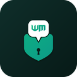
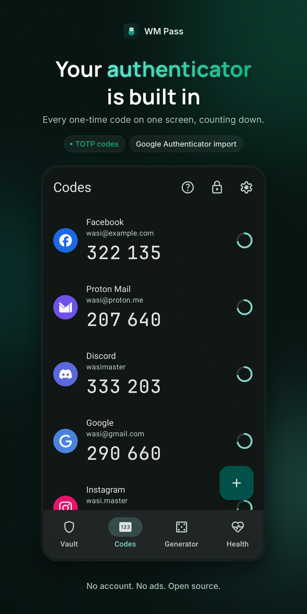
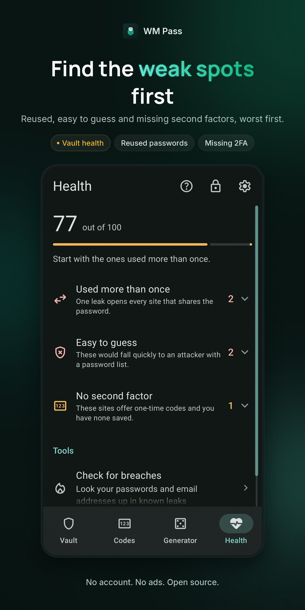
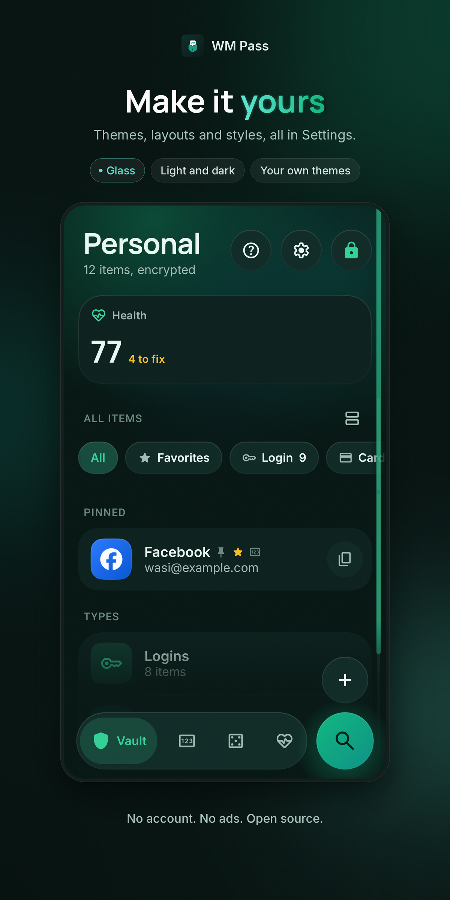

<div align="center">



# WM Pass

### Your passwords, on your own devices.

An open source password manager with autofill, passkeys, one-time codes and encrypted backups.
There is no account to make, it works with the network off, and every network feature starts
switched off.

<a href="https://github.com/wasi-master/wm-pass/releases"></a>
<a href="https://github.com/wasi-master/wm-pass/releases"></a>
<a href="https://github.com/wasi-master/wm-pass/actions/workflows/ci.yml"></a>
<a href="https://wmpass.pages.dev"></a>
<a href="https://wmpass.pages.dev/vault/"></a>
<a href="LICENSE"></a>

<a href="#install">Install</a> · <a href="#the-tour">Tour</a> · <a href="#security">Security</a> · <a href="#android-builds">Builds</a> · <a href="#faq">FAQ</a> · <a href="#build-it-yourself">Build</a> · <a href="https://wmpass.pages.dev"><b>Read the docs</b></a>

</div>

## Why it exists

A password manager holds the keys to everything else, and most of them ask you to hand that
over to a company's server in exchange for sync. The account becomes the product, the server
becomes the target, and leaving means trusting an export button.

WM Pass starts from the other end. The vault is one encrypted file that lives on your devices.
Nothing about it needs a server of mine, and nothing leaves the device unless you turn a feature
on and point it somewhere. Backups and sync still work, through a folder, a cloud drive, a server
you run, or straight across your local network, but every one of those places only ever holds
the encrypted file.

It runs on Android, macOS, Windows, Linux, Chrome, Firefox, a browser tab, the terminal and
Wear OS, and all of them share one Rust core, so a vault means the same thing everywhere.

## A few screenshots

<table>
  <tr>
    <td></td>
    <td></td>
    <td></td>
    <td></td>
    <td></td>
    <td></td>
    <td></td>
    <td></td>
  </tr>
</table>

## It starts with one file

Everything in a vault lives in one `.wmvault` file. Without a way in, it is random-looking bytes
of a fixed shape, so it can sit in a backup folder, a cloud drive or a server you do not trust.

| A way in | What it opens | What it costs a thief |
|---|---|---|
| Master password | A slot holding a copy of the random vault key | Argon2id with at least 64 MiB of memory per guess. Readers refuse anything weaker |
| Password and key file | The same key, from a slot that needs both | The file as well as the password |
| Password and security key | The same key, from a slot that asks a hardware security key | The physical key as well |
| Duress password | A decoy vault of the same shape beside the real one | Nothing to see: unused slots are random bytes, so the file does not say how many ways in it has |

The contents are padded and sealed in chunks with a fresh key on every save, so a cut or
rearranged file fails to open and an older copy can be told from a newer one. The whole format
is [published byte by byte](https://wmpass.pages.dev/security/format/).

## The tour

### The vault

- **Twelve kinds of item**: logins, one-time codes, notes, cards, identities, recovery codes,
  Wi-Fi networks, SSH keys, API keys, databases, licenses and documents. Each has the fields that
  kind of thing needs, plus folders, tags, colors, custom fields, attachments and history.
- **Search with filters**: `tag:work`, `kind:card`, `site:github`, `has:otp`, `weak`, `reused`,
  `modified<30d`. Typos of a letter or two still match. Secrets are never searched.
- **One-time codes** for every account on one screen, with Google Authenticator transfer codes
  imported by scanning them.
- **A generator** for random passwords, word passphrases and pronounceable ones, with the time to
  crack shown as you change it.
- **Health**: reused, weak, old and breached passwords and missing second factors, worst first,
  with the site's own change-password page one tap away.
- **Self-destruct dates, reminders, a trash and a hidden shelf** for items that should not show in
  the list.

[How it works](https://wmpass.pages.dev/guide/how-it-works/) · [Screens](https://wmpass.pages.dev/guide/screens/) · [Every setting](https://wmpass.pages.dev/guide/)

### Filling

- **Android autofill** that matches apps by package name and signing certificate, never by name
  alone. A login never fills without your tap.
- **Passkeys** on Android 14 and up, and in the browser extension.
- **A browser extension** for Chrome and Firefox. A small key appears in login fields; nothing fills
  when a page loads, and the menu ignores clicks that land too soon or on a covered page.
- **Quick search and auto-type** on the desktop, from a global shortcut.
- **An SSH agent** on the desktop that answers `ssh` and `git` with Ed25519 keys from the vault,
  asking before each use.
- **WM Keyboard** can browse, type from and add to the vault, and keep its own API keys there.

[Android](https://wmpass.pages.dev/apps/android/) · [Desktop](https://wmpass.pages.dev/apps/desktop/) · [Extension](https://wmpass.pages.dev/apps/extension/) · [WM Keyboard](https://wmpass.pages.dev/apps/keyboard/)

### Backups and sync

| | |
|---|---|
| **A folder** | On the device, for Syncthing or a cloud provider's own app to carry on from |
| **An account** | Google Drive, Dropbox, OneDrive, Box, pCloud, MEGA, iCloud Drive, Proton Drive |
| **A server** | WebDAV, S3, SFTP, FTP, SMB, NFS, Synology and QNAP. WebDAV and S3 fill in the address for Nextcloud, Backblaze B2, Cloudflare R2 and two dozen more |
| **Somewhere odd** | A Git repository on GitHub, GitLab, Gitea or Forgejo, or a mailbox over IMAP |
| **Your local network** | Two devices sync directly, with no server, after pairing once by QR code or six digits |
| **An account you already have** | A Bitwarden or Vaultwarden account, a KeePass database opened in place, or the WM Pass server you run yourself |

Each new backup is read back and checked before older ones are removed. Sync merges field by
field, and when two devices changed the same password, the losing value goes into the item's
history, so a conflict never destroys a password.

[Backup and sync](https://wmpass.pages.dev/guides/backup-sync/) · [The LAN protocol](https://wmpass.pages.dev/security/lan/)

### Under pressure

- **Duress password**: opens a decoy vault, and takes the same time to unlock as the real one.
- **Hidden vaults** inside a vault, and a hidden shelf for single items.
- **Emergency access**: split a recovery key between people you trust, so that enough of them
  together can open the vault.
- **Panic controls** on Android: a Panic lock tile that refuses every password for an hour, and
  panic apps such as Ripple can lock or wipe the vault once you allow them.

These are for getting through a quick look. They do not defeat forensics, and
[the duress guide](https://wmpass.pages.dev/guides/duress/) says where they stop.

[Duress](https://wmpass.pages.dev/guides/duress/) · [Emergency access](https://wmpass.pages.dev/guides/emergency-access/)

### Everywhere you are

| | |
|---|---|
| **Android** | Autofill, passkeys, widgets, Quick Settings tiles, app shortcuts, screenshots blocked by default |
| **Wear OS** | One-time codes and favorites while the phone's vault is open. The watch keeps nothing |
| **macOS, Windows, Linux** | The full app with quick search, auto-type, the SSH agent, a tray icon, and widgets on a Mac |
| **Chrome and Firefox** | Its own vault, filling and saving, passkeys, and a link to the desktop app over Noise |
| **Any browser tab** | The [web vault](https://wmpass.pages.dev/vault/), the same engine as WebAssembly, with no server side |
| **The terminal** | `wmpass`, a full-screen terminal app with the same vault as the desktop app, plus subcommands for scripts |

[Terminal](https://wmpass.pages.dev/apps/terminal/) · [Web vault](https://wmpass.pages.dev/apps/web/) · [Watch](https://wmpass.pages.dev/apps/watch/)

### Moving in

Import reads exports from 39 password managers and authenticators, among them 1Password,
Bitwarden, LastPass, KeePass, Proton Pass, Dashlane, Aegis, 2FAS, Apple Passwords and every major
browser. Each one has its own export steps in the app and on the site, and export goes the other
way just as easily.

[Import and export](https://wmpass.pages.dev/guides/import-export/)

## Security

- No analytics, no crash reporting, no advertising, no account, and no server of mine that your
  data passes through.
- Every network feature starts off and says what it sends before you turn it on. Backups and sync
  send the vault file as it is stored, encrypted under keys that never leave your device.
- Keys stay in Rust and are wiped on lock. Secret fields never cross into the interface unless you
  choose to see or type one.
- The extension and desktop app talk over Noise XX through a relay that holds no keys, paired by a
  code compared on both screens.
- Only RustCrypto and dalek primitives, with no new constructions. `cargo deny` checks licences and
  advisories on every change, and desktop updates carry a minisign signature the app verifies.
- The honest gap: no outside audit of the core has been done yet. One is planned before 1.0.

[Threat model](https://wmpass.pages.dev/security/threat-model/) · [File format](https://wmpass.pages.dev/security/format/) · [Privacy policy](https://wmpass.pages.dev/privacy/) · [Reporting a vulnerability](SECURITY.md)

## Android builds

One app, three builds. The vault, autofill, passkeys, backups and everything else about your
passwords behave the same in each.

| | Standard | F-Droid | Offline |
|---|:---:|:---:|:---:|
| Gradle flag | none | `-Pwmpass.fdroid=true` | `-Pwmpass.offline=true` |
| Wear OS app | ✓ | | |
| ML Kit | ✓ | | |
| Google's SDKs | Wearable API, ML Kit | none | none |
| Local network sync | ✓ | ✓ | |
| Internet permission | ✓ | ✓ | |

The offline build has no internet permission, so no line of code in it can reach a network.

## Install

<p>
<a href="https://github.com/wasi-master/wm-pass/releases"></a>
<a href="https://apps.obtainium.imranr.dev/redirect?r=obtainium://add/https://github.com/wasi-master/wm-pass"></a>
</p>

- **Android**: the APK from [GitHub releases](https://github.com/wasi-master/wm-pass/releases).
  F-Droid and Play listings will follow. Needs Android 8.0 or newer.
- **macOS, Windows and Linux**: downloads on the same page, or through Homebrew and the AUR.
- **Terminal**: `wmpass` for macOS, Linux and Windows, under release tags that start with `cli-v`.
- **Browser**: the extension under tags that start with `extension-v`. Firefox installs the signed
  `wm-pass-firefox.xpi`; in Chrome, Edge or Brave, unzip `wm-pass-chrome.zip` and use Load unpacked.
- **No install at all**: the [web vault](https://wmpass.pages.dev/vault/) runs in any Chrome, Edge
  or Firefox tab.

```bash
brew install --cask wm-pass
```

```bash
yay -S wm-pass-bin
```

Desktop builds carry no Apple or Windows signature, so macOS and Windows warn the first time you
open them. That also means the warning cannot vouch for the file, so check it against the
`SHA256SUMS` file on each release. Later updates verify a minisign signature on their own.

[Install](https://wmpass.pages.dev/start/install/) · [Your first vault](https://wmpass.pages.dev/start/first-vault/)

## FAQ

<details>
<summary><b>What happens if I forget my master password?</b></summary>
<br>
There is no account and no server holding a copy, so there is no reset link. The vault opens
only with another way in you set up beforehand: a second password, an emergency kit, or emergency
shares held by people you trust. Keep a written copy of the password somewhere safe until you know
it by heart.
</details>

<details>
<summary><b>Is anything sent anywhere?</b></summary>
<br>
Not unless you turn something on. Every network feature, from backups and sync to breach checks and
website icons, starts off, and each talks only to the service it names. What reaches a backup place
is the encrypted file, which that place cannot read. The <a href="https://wmpass.pages.dev/privacy/">privacy policy</a>
lists what each cloud service can see.
</details>

<details>
<summary><b>How do I keep my phone and computer in step?</b></summary>
<br>
Turn on sync for any backup place both devices can reach, and each leaves its own encrypted copy
there and merges the others'. Or pair them once on the same network and they sync directly, with no
server at all. <a href="https://wmpass.pages.dev/guides/backup-sync/">Backup and sync</a> covers both.
</details>

<details>
<summary><b>Can I keep using my Bitwarden account?</b></summary>
<br>
Yes. A Bitwarden or Vaultwarden account can stand in for a local vault, and so can a KeePass
database opened where it is. Bitwarden does not publish its API, so a change on their side can
break this.
</details>

<details>
<summary><b>macOS or Windows says the app is not safe.</b></summary>
<br>
The desktop builds are not signed with an Apple or Windows certificate. On macOS 15 and later, try
to open it once, then choose Open Anyway under System Settings, Privacy &amp; Security; on 14 and
earlier, right-click and choose Open. On Windows, choose More info, then Run anyway. The Homebrew
cask clears the macOS warning for you.
</details>

<details>
<summary><b>Has it been audited?</b></summary>
<br>
Not yet. A third-party audit of the core is planned before 1.0. Until then, the
<a href="https://wmpass.pages.dev/security/threat-model/">threat model</a> and the
<a href="https://wmpass.pages.dev/security/format/">file format</a> are published for anyone who
wants to check the work.
</details>

## Documentation

**<a href="https://wmpass.pages.dev">wmpass.pages.dev</a>** is the full manual, and the same guide
the app shows when you press <kbd>?</kbd> or <kbd>F1</kbd>.

| Start here | Go deeper |
|---|---|
| [Install](https://wmpass.pages.dev/start/install/) | [How it works](https://wmpass.pages.dev/guide/how-it-works/) |
| [Your first vault](https://wmpass.pages.dev/start/first-vault/) | [Threat model](https://wmpass.pages.dev/security/threat-model/) |
| [Import from another app](https://wmpass.pages.dev/guides/import-export/) | [File format](https://wmpass.pages.dev/security/format/) |
| [Backup and sync](https://wmpass.pages.dev/guides/backup-sync/) | [The LAN protocol](https://wmpass.pages.dev/security/lan/) |
| [Every setting](https://wmpass.pages.dev/guide/) | [Duress](https://wmpass.pages.dev/guides/duress/) |

The source lives in [`docs/`](docs/) and runs on Astro Starlight. The guide pages are generated
from `help/topics/` by `npm run help`, so edit those rather than the pages.

## Community

- **Bugs and feature requests:** [GitHub issues](https://github.com/wasi-master/wm-pass/issues).
- **Security reports:** through [private vulnerability reporting](SECURITY.md), never a public issue.

## Build it yourself

You need the Rust toolchain pinned in `rust-toolchain.toml` and Node.js. The Android app also needs
the NDK and `cargo-ndk`.

```bash
git submodule update --init
```

```bash
cargo test --workspace
```

```bash
npm ci && npm run extension:build
```

```bash
cargo tauri build
```

```bash
cargo run -p wmpass-cli
```

The `cargo tauri build` step runs from `desktop/src-tauri`, and `cargo run -p wmpass-cli` opens the
terminal app. The Android app builds from `android/` with `./gradlew assembleDebug`. Pass
`-Pwmpass.fdroid=true` to leave out Google's SDKs (the Wearable API and ML Kit), or
`-Pwmpass.offline=true` to drop the internet permission and those SDKs with it.

<details>
<summary><b>Project layout</b></summary>

<br>

One Rust core with no platform code and no network, and a shell for each platform on top of it.

```
crates/
├── wmpass-core/          Vault format, key slots, model, merge, generator, health, search,
│                         import and export. No platform code and no network
├── wmpass-session/       The session every shell talks to, over one frame format
├── wmpass-net, -sinks,   Network features, backup places, local network sync,
│   -lan, -bw, -hwkey     Bitwarden client, hardware keys
├── wmpass-bridge, -host  The sealed conversation between extension and desktop app, and the relay
├── wmpass-server/        A server you can run yourself (Docker setup in packaging/server)
├── wmpass-cli, -tui      wmpass: the full-screen terminal app, and subcommands for scripts
└── wmpass-jni, -wasm,    The bindings for Android, browsers and other shells
    -ffi
android/                  The Android app, Wear OS app and the watch link
ui/                       Svelte screens shared by desktop, extension and the web vault
desktop/                  The Tauri desktop app
extension/                The Chrome and Firefox extension
web/                      The web vault, served at wmpass.pages.dev/vault
help/                     The in-app guide, which also generates the docs' guide pages
docs/                     The documentation site
packaging/                Release notes and recipes for each channel
```

</details>

<details>
<summary><b>Extension, web vault and release workflows</b></summary>

<br>

The extension build writes `extension/dist/chrome` and `extension/dist/firefox`, and
`npm run extension:lint` checks the Firefox one with Mozilla's `web-ext`. The `Extension release`
workflow runs from an `extension-v*` tag that matches the manifest's version, and has Mozilla sign
the Firefox build as an unlisted add-on when the `AMO_JWT_ISSUER` and `AMO_JWT_SECRET` secrets hold
an addons.mozilla.org API key; without them the release has only the unsigned zip.

The browser tests run with `node extension/test/run.mjs` after building the extension, and
`node web/test/run.mjs` after `npm run web:build`. `npm run site:build` puts the web vault under the
docs site's `/vault/`, with its headers from `docs/public/_headers`; the `Site release` workflow
publishes it from a `site-v*` tag, with the `CLOUDFLARE_API_TOKEN` and `CLOUDFLARE_ACCOUNT_ID`
secrets.

</details>

<details>
<summary><b>Cloud storage app ids</b></summary>

<br>

Google Drive, Dropbox, OneDrive and Box need WM Pass registered in each service's console, and a
build offers only the services it was given ids for. The ids are not secrets apart from Box's and
Google's client secrets, which those services require even from apps on a device.

| Service | Android (`local.properties` or `-P`) | Desktop and extension (environment, at build time) | Redirect to register |
|---|---|---|---|
| Google Drive | `wmpass.driveClientId` (an iOS-type client) | `WMPASS_DRIVE_DESKTOP_CLIENT_ID`, `WMPASS_DRIVE_DESKTOP_SECRET`; extension and web vault `WMPASS_DRIVE_WEB_CLIENT_ID`, `WMPASS_DRIVE_WEB_SECRET`, each from a Web application client of its own (the site workflow reads the web vault's from `WMPASS_SITE_DRIVE_CLIENT_ID` and `WMPASS_SITE_DRIVE_SECRET`). The extension's client lives in a Google Cloud project of its own, because Google verifies a sign-in screen's branding only when it owns every domain on it, and nobody can own `chromiumapp.org` or Mozilla's `extensions.allizom.org` | Android: the reversed client id; desktop: `http://127.0.0.1:53683/oauth`; extension: `https://<extension id>.chromiumapp.org/oauth` in Chrome and `https://8e32a3708f838c329854e352624417ca6864c904.extensions.allizom.org/oauth` in Firefox (the SHA-1 of the add-on id `wmpass@wasimaster.com`); web vault: `https://wmpass.pages.dev/vault/oauth.html` |
| Dropbox | `wmpass.dropboxAppKey` | `WMPASS_DROPBOX_APP_KEY` | `wmpass://oauth`, `http://127.0.0.1:53683/oauth`, the extension's two, the web vault's |
| OneDrive | `wmpass.oneDriveClientId` | `WMPASS_ONEDRIVE_CLIENT_ID` | `wmpass://oauth` and `http://127.0.0.1:53683/oauth` as "Mobile and desktop" redirects; the extension's two and the web vault's as "Single-page application" |
| Box | `wmpass.boxClientId`, `wmpass.boxClientSecret` | `WMPASS_BOX_CLIENT_ID`, `WMPASS_BOX_CLIENT_SECRET` | `https://wmpass.pages.dev/oauth/`, `http://127.0.0.1:53683/oauth`, the extension's two, the web vault's; and `https://wmpass.pages.dev` as an allowed origin |

</details>

## Contributing

The easiest first contributions are not code: try the app, and report what breaks or what you
miss. Export steps for a password manager that is not on the import list are welcome too.

For code: commits follow Conventional Commits, `type(scope): summary`. Run `cargo test --workspace`
and `cargo clippy` before you open a pull request, and open an issue first for anything larger than
a fix so we can agree on the shape of it.

## Credits

WM Pass is built on RustCrypto and dalek for its cryptography, Tauri for the desktop app and Svelte
for the shared screens. Its bundled data comes from the [2FA directory](https://2fa.directory),
[Wikidata](https://www.wikidata.org), Apple's
[password-manager-resources](https://github.com/apple/password-manager-resources), Stripe's
CardScan model and the EFF word lists. [data/README.md](data/README.md) lists every source with its
licence.

MIT licensed. See [LICENSE](LICENSE).
